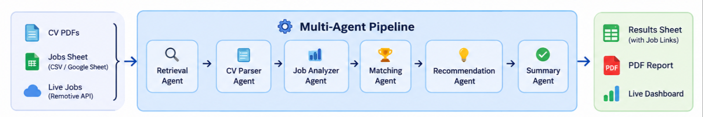

# Multi-Agent CV ↔ Job Matcher

An AI-powered multi-agent system that analyzes CVs, evaluates job opportunities, and generates personalized job recommendations.

The system uses **Qwen2.5 open models** to extract information from CVs and job descriptions, while a code-based matching engine calculates scores and ranks opportunities. It provides results through a Streamlit dashboard, a downloadable CSV file, and a PDF report.

[](https://colab.research.google.com/github/RawanBadr24/cv-job-matcher/blob/main/CV_Job_Matcher_Multi_Agent.ipynb)

<p align="center">
  
</p>


## Key Features

- **Multiple CV Uploads:** Upload and analyze multiple CV PDFs through a Streamlit interface.
- **Multiple Job Sources:** Retrieve opportunities from uploaded CVs, a jobs CSV/Google Sheet, and the Remotive public jobs API.
- **AI-Powered CV Parsing:** Extract candidate information, skills, and years of experience using an LLM.
- **Job Requirement Analysis:** Identify required skills and experience levels from job descriptions.
- **Experience-Level Filtering:** Identify jobs that require significantly more experience than the candidate has and mark them as *Too senior*.
- **Explainable Job Matching:** Calculate matching scores using code-based skill comparison and experience rules.
- **Personalized Recommendations:** Generate career suggestions for each candidate.
- **Automated Reports:** Export ranked job results as CSV and generate a PDF report.
- **Evaluation:** Test model performance using accuracy, valid JSON rate, execution speed, and error handling. A live evaluation tab also checks extracted skills against the original CV text.

## How It Works

The system follows a multi-agent workflow:

| Agent | Type | Responsibility |
|---|---|---|
| Retrieval Agent | Code | Reads CV PDFs, retrieves jobs from the jobs sheet, and fetches live opportunities from Remotive. |
| CV Parser Agent | LLM | Extracts candidate information, skills, and years of experience. |
| Job Analyzer Agent | LLM + Rules | Extracts required skills and identifies experience requirements. |
| Matching Agent | Python | Calculates matching scores, applies experience-level filtering, and ranks jobs. |
| Recommendation Agent | LLM | Generates personalized career recommendations. |
| Summary Agent | LLM | Produces an overall summary of the matching results. |

### Why Is Matching Code-Based?

The LLMs handle language understanding and information extraction, while Python handles the actual scoring and ranking.

This separation makes the matching process more consistent, predictable, and easier to explain than relying on an LLM to calculate scores directly.

## Outputs

The system generates three main outputs:

1. **Ranked Results Sheet:** A CSV file containing matching results and job application links.
2. **PDF Report:** A report summarizing the matching results and recommendations.
3. **Live Dashboard:** An interactive Streamlit interface for exploring candidates, jobs, and evaluation results.

## Getting Started

### Option 1: Google Colab (Recommended)

Google Colab is recommended because it provides access to GPU resources without requiring a local GPU.

1. Open the notebook using the **Open in Colab** badge above.
2. Change the runtime type to GPU.
3. Run all notebook cells.
4. Follow the instructions in the notebook to launch the Streamlit application.

### Option 2: Run Locally

Clone the repository:

```bash
git clone https://github.com/RawanBadr24/cv-job-matcher.git
cd cv-job-matcher
```

Install the required dependencies:

```bash
pip install -r requirements.txt
```

Run the Streamlit application:

```bash
streamlit run app.py
```

**Note:** The first run downloads the Qwen2.5 model. A GPU is strongly recommended for better performance.

## Jobs Dataset Format

You can provide job opportunities using a CSV file or a Google Sheet published as CSV.

The dataset should contain the following columns:

| Column | Description |
|---|---|
| `title` | Job title |
| `company` | Company name |
| `description` | Job description and requirements |
| `link` | Optional job application URL |

An example dataset is available at:

`sample_data/jobs_example.csv`

## Model Evaluation

The project includes an evaluation workflow to assess the reliability of the AI components.

Evaluation criteria include:

- **Accuracy:** Measures the correctness of predictions on a labeled test set.
- **Valid JSON Rate:** Checks whether model outputs follow the expected JSON format.
- **Execution Speed:** Measures processing time.
- **Error Handling:** Tests how the system handles invalid or incomplete inputs.
- **Live Evaluation:** Checks extracted CV skills against the actual text extracted from the uploaded document.

## Limitations

- The Qwen2.5-1.5B model may occasionally miss, misinterpret, or rename skills. Larger models may improve extraction quality.
- Scanned or image-only PDFs are skipped because they do not contain directly extractable text.
- Matching currently focuses on skills and experience level. It does not evaluate location, salary, or education requirements.
- Experience requirements are identified using simple rules applied to job titles and descriptions. Jobs without explicit seniority requirements are treated as open to all experience levels.

## Project Structure

```text
cv-job-matcher/
│
├── CV_Job_Matcher_Multi_Agent.ipynb
├── agents.py
├── app.py
├── requirements.txt
│
├── sample_data/
│   └── jobs_example.csv
│
└── architecture.png
```

## Technologies Used

- **Python** – Core application logic and matching engine.
- **Qwen2.5** – Open-source language model for CV and job analysis.
- **Streamlit** – Interactive web application and dashboard.
- **PDF Processing** – CV text extraction.
- **Pandas** – Dataset processing and CSV generation.
- **Google Colab** – Cloud-based development and GPU execution.
- **Remotive API** – Live job opportunity retrieval.

---

**Developed by Rawan Badr El din Kamal**
